# 👋 Bonjour, je suis Aimé Lim Houn Tchen

Master 2 Informatique à l'INSA Hauts-de-France (Valenciennes) · BUT Informatique à l'IUT Nancy-Charlemagne

🔎 Je recherche un stage de fin d'études à partir de mars 2027.

- ☕ Java : back-end (Spring Boot), applications de bureau (JavaFX), systèmes répartis (RMI, sockets)
- 📈 Centres d'intérêt : optimisation et recherche opérationnelle

#### Technologies

#### Projets

| Projet | Description | Technologies |
|---|---|---|
| [API de gestion des Pals](https://github.com/LimHounTchenAime/api_gestion_pals) | API REST documentée avec Swagger, testée avec MockMvc | Spring Boot, JPA, H2 |
| [Générateur de diagrammes UML](https://github.com/LimHounTchenAime/generateur-uml-javafx) | Diagramme de classes construit par introspection à partir de fichiers Java glissés dans la fenêtre | Java, JavaFX, Maven |
| [Carte de Nancy et services RMI](https://github.com/LimHounTchenAime/carte-nancy-rmi) | Carte Leaflet alimentée par des API publiques et un backend Java RMI derrière un proxy HTTPS | Java RMI, JavaScript, MariaDB |
| [SocketChat](https://github.com/LimHounTchenAime/socketchat) | Messagerie en temps réel : serveur TCP multi-clients et client graphique échangeant des objets sérialisés | Java, sockets, JavaFX |
| [Bellman-Ford et Dijkstra](https://github.com/LimHounTchenAime/bellman-ford-dijkstra) | Plus court chemin, comparaison expérimentale sur 96 graphes, résolution de labyrinthes | Java, JUnit |
| [IA : réseaux de neurones et recherche](https://github.com/zhishengtrieu/SAE_IA) | Perceptron multicouche et kNN (MNIST), recherche dans un espace d'états (BFS, A*, Rush Hour), jeux à deux joueurs (Minimax, alpha-bêta). Projet à trois | Java, Maven |
| [Crazy Charly Day 2024](https://github.com/zhishengtrieu/Crazy-Charly-Day) 🏆 | Inscriptions aux ateliers culinaires d'une association : questionnaire, back-office, répartition des candidats. Réalisé en une journée à cinq, équipe gagnante | NestJS, Vue.js, MariaDB |
| [Leon App](https://github.com/LimHounTchenAime/LeonApp-VocabVoiceLearning) | Apprentissage du vocabulaire par synthèse vocale, application monopage | JavaScript, Web Speech API, Jest |

#### Statistiques

    
    

